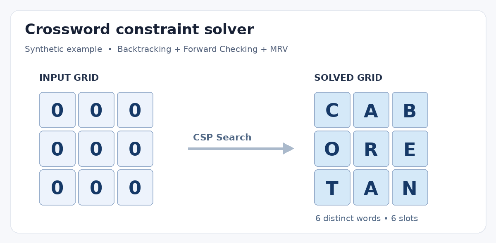

# Crossword CSP Solver — Backtracking, Forward Checking & MRV

A **Python crossword solver** built for *Knowledge, Reasoning and Uncertainty* at the **Universitat Autònoma de Barcelona (UAB)**. This three-person team project models a crossword as a **constraint satisfaction problem (CSP)**, finding word assignments that agree at intersections and never reuse a word.

The algorithm was developed **from scratch by the student team**; the professor supplied the original dictionaries and crossword test boards.



## What it does

- Detects horizontal and vertical word slots from a grid of `0` (empty) and `#` (blocked) cells.
- Filters dictionary words by slot length to build initial domains.
- Uses **recursive backtracking** to explore assignments.
- Applies **forward checking** at intersections to prune incompatible candidates early.
- Selects the next variable with the **Minimum Remaining Values (MRV)** heuristic.
- Prevents assigning the same word twice and prints the completed crossword.

## Run it

**Requirements:** Python 3.10+; no third-party packages.

```bash
python run.py
```

The default run uses a **small, self-contained example written for this public portfolio** (not UAB course data).

To use your own files:

```bash
python run.py --board path/to/board.txt --dictionary path/to/words.txt
```

Boards consist of `0` and `#` characters (spaces and tabs are accepted). The word list contains one word per line. The original course wordlists and boards are **not distributed** in this repository; if you have legitimate access, you can pass them as file paths without committing them to Git.

## Example output

```text
Solved crossword:
C A B
O R E
T A N
Slots: 6 | Unique words: 6
```

The original submission can be inspected at [`original/code.py`](original/code.py). It reads from its original relative `MaterialsPractica/` paths. The more reusable command-line version is at [`src/crossword_solver.py`](src/crossword_solver.py).

## Coursework and results

| Part | Problem | Method taught / developed |
| --- | --- | --- |
| C | Small 7×6 crossword, 107-word dictionary | Backtracking baseline |
| B | Same small crossword | Forward checking |
| A | Larger 12×12 crossword, 581,980-word dictionary | Forward checking + MRV |

The **submitted code** combines backtracking, forward checking and MRV; it does not preserve separate original implementations for each part. In a local run with the original university data, the submitted code produced solutions for both boards. The large board completed in **approximately 3.64 seconds** in that run. [Benchmark notes](docs/benchmarks.md).

The group report describes the evolution from an inefficient first approach to checking only neighboring word slots, while also avoiding duplicate words. See [approach and limitations](docs/approach.md) for the actual constraint model.

## My contributions and teamwork

The solver was implemented collaboratively by a **three-person group**. My documented contributions included:

- Developing and testing backtracking and forward checking, mainly for Parts C and B.
- Improving forward checking by checking the **required crossing letter directly**, instead of repeatedly evaluating every constraint for every candidate.
- Helping adapt the search to larger vocabulary inputs.
- Writing the report sections covering the CSP formulation, variables/domains, constraints and proposed solution.

More details: [authorship and attribution](docs/attribution.md).

## Project structure

```text
.
├── README.md
├── run.py                      # Command-line demo
├── src/crossword_solver.py     # Portfolio-friendly version of the solver
├── original/
│   ├── code.py                 # Original team submission
│   └── reduir_txts.py         # Original dictionary sampling helper
├── examples/                   # Synthetic demo data for this portfolio
├── tests/test_solver.py        # Self-contained automated tests
├── assets/crossword-demo.png   # Example output visualization
├── docs/                       # Approach, benchmarks and attribution
└── .github/workflows/tests.yml # Python CI
```

## Tests

```bash
python -m unittest discover -s tests -v
```

GitHub Actions runs the tests and the synthetic demo on every push. This automated verification **does not require any UAB-provided materials** and is separate from the historical course benchmarks.

## Academic context

- **Course:** Coneixement, Raonament i Incertesa (Knowledge, Reasoning and Uncertainty)
- **University:** Universitat Autònoma de Barcelona
- **Academic year:** 2026–2027
- **Type:** three-person coursework project
- **Language:** Python

*This is a constraint-solving program, not a graphical crossword application or a machine-learning model.*
